<div align="center">

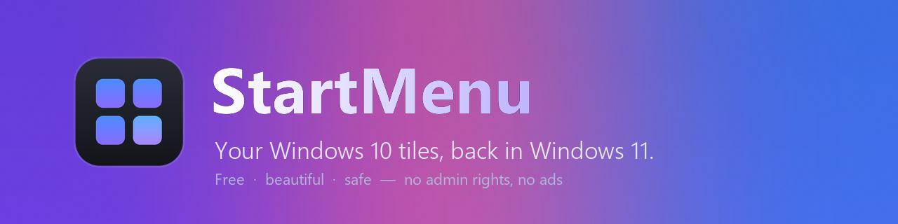

**English** · [Русский](README.ru.md)

[](https://github.com/NKF-XXX/StartMenu/releases/latest)

[](https://github.com/NKF-XXX/StartMenu/releases/latest)
[](https://github.com/NKF-XXX/StartMenu/releases)
[](LICENSE)
[](#-install-in-one-minute)
[](https://www.qt.io/)

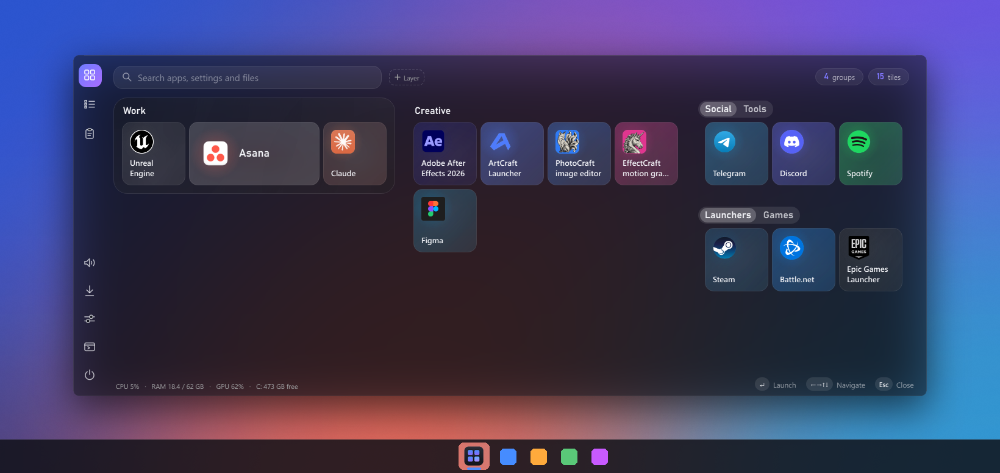

**Groups · folders · 4 tile sizes · instant search**<br>
Doesn’t patch Windows · no admin rights · no ads · free forever

</div>

## 🎨 Four styles

<table>
  <tr>
    <td width="50%">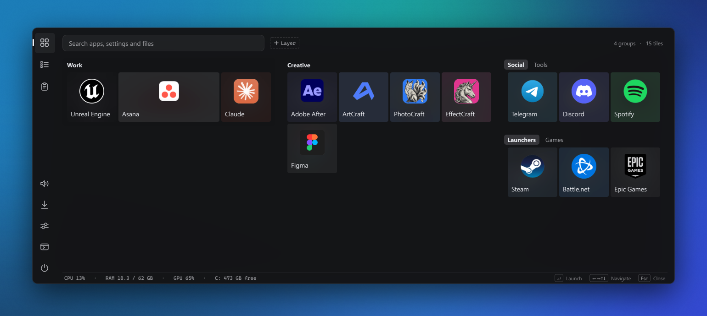<p align="center"><b>Classic</b></p></td>
    <td width="50%">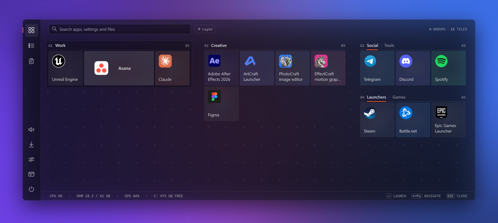<p align="center"><b>Studio</b></p></td>
  </tr>
  <tr>
    <td width="50%">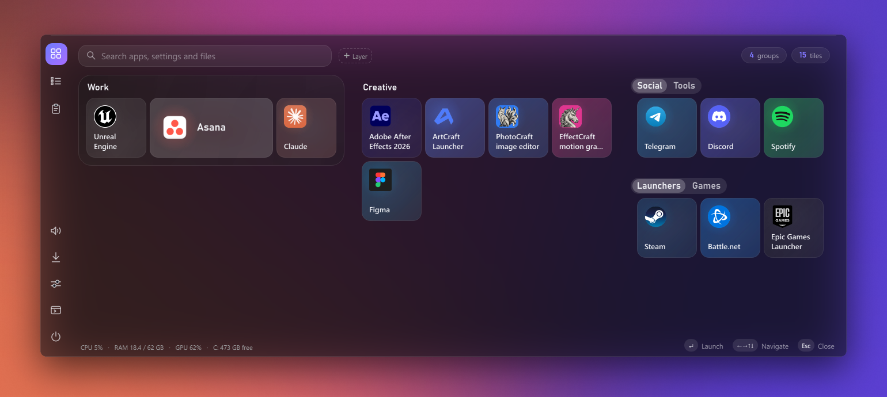<p align="center"><b>Bento</b></p></td>
    <td width="50%">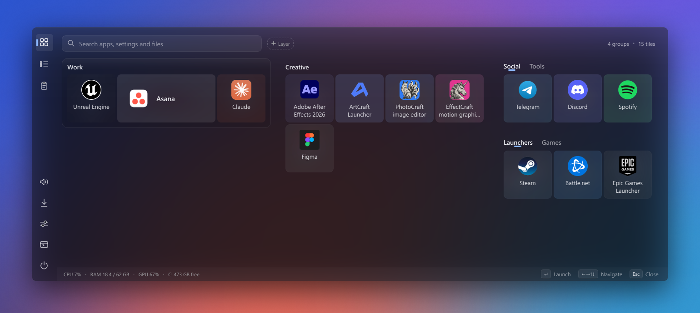<p align="center"><b>Fluent</b></p></td>
  </tr>
</table>

## 🧩 Make it yours

Labels or clean icons, glass or solid — colors, corners and size are yours too.

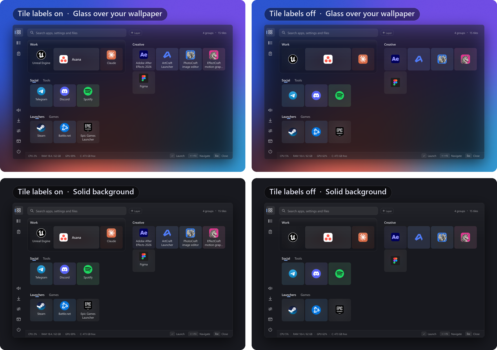

## 🎵 Music player

Whatever plays in Windows — a separate panel above the menu with seeking and a beat glow.

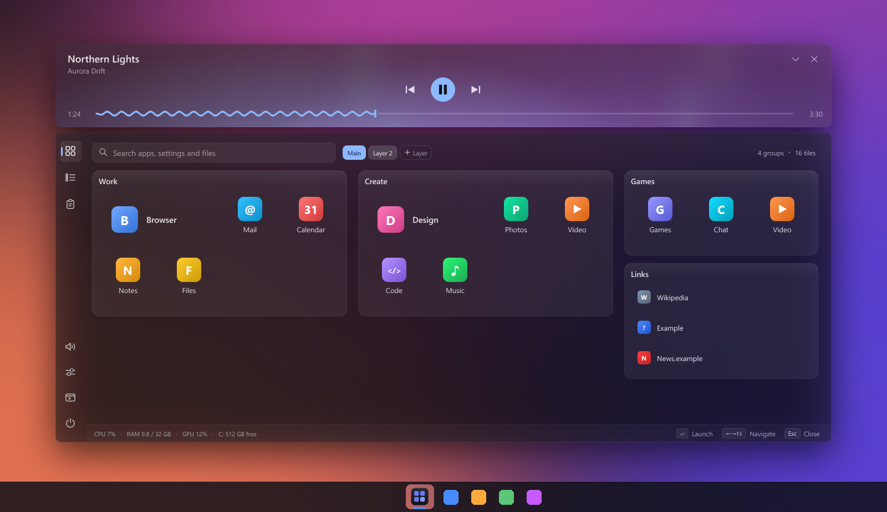

<table>
  <tr>
    <td width="50%">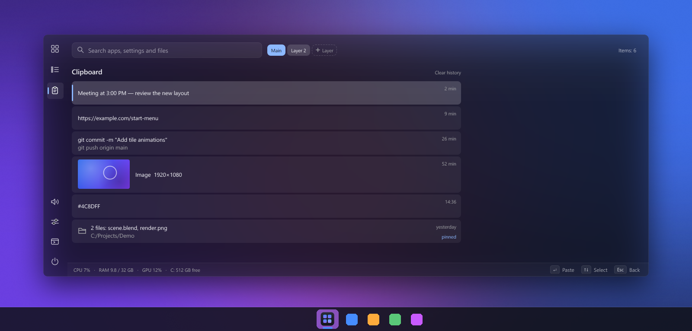<p align="center"><b>📎 Clipboard history</b></p></td>
    <td width="50%">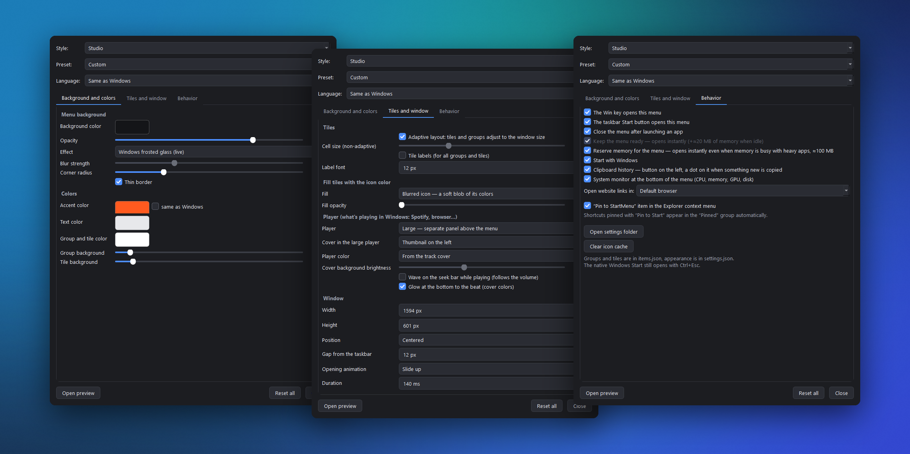<p align="center"><b>⚙️ Every detail in settings</b></p></td>
  </tr>
</table>

<p align="center">
🔎 Search apps, settings & files &nbsp;·&nbsp; 🧮 Calculator &nbsp;·&nbsp; ⌨️ Fixes the wrong keyboard layout &nbsp;·&nbsp; 📑 Layers<br>
🔊 Volume & output &nbsp;·&nbsp; 📊 System monitor &nbsp;·&nbsp; 🌐 Website links &nbsp;·&nbsp; 📌 Pin from Explorer &nbsp;·&nbsp; 🎮 Works over games
</p>

## 📦 Install in one minute

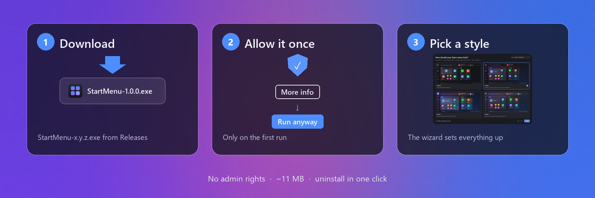

The first-run wizard does the rest:

<table>
  <tr>
    <td width="33%">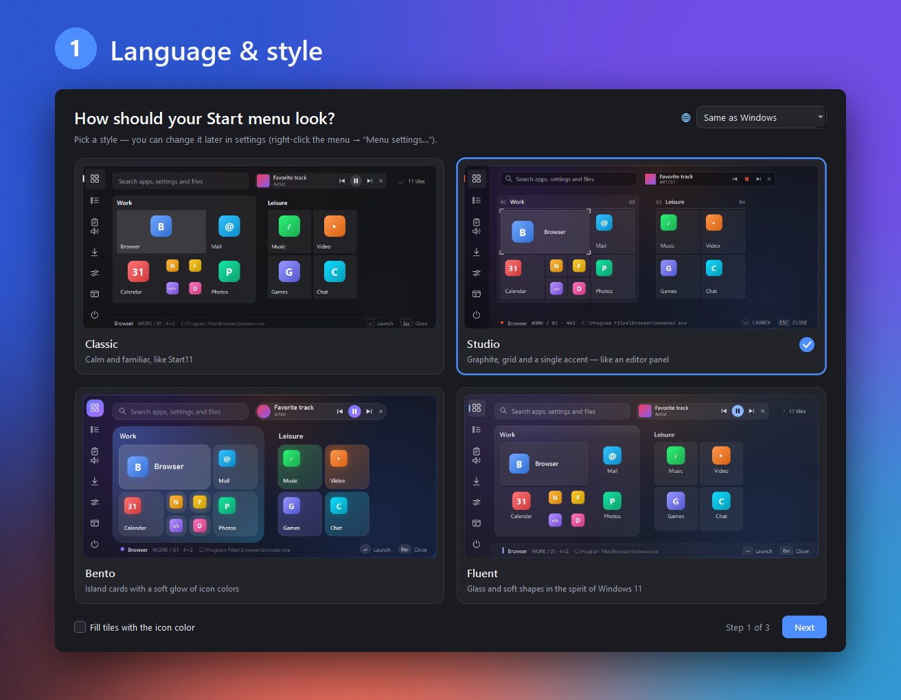</td>
    <td width="33%">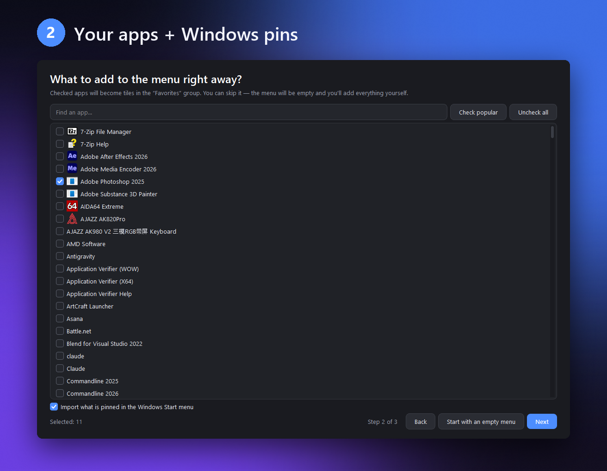</td>
    <td width="33%">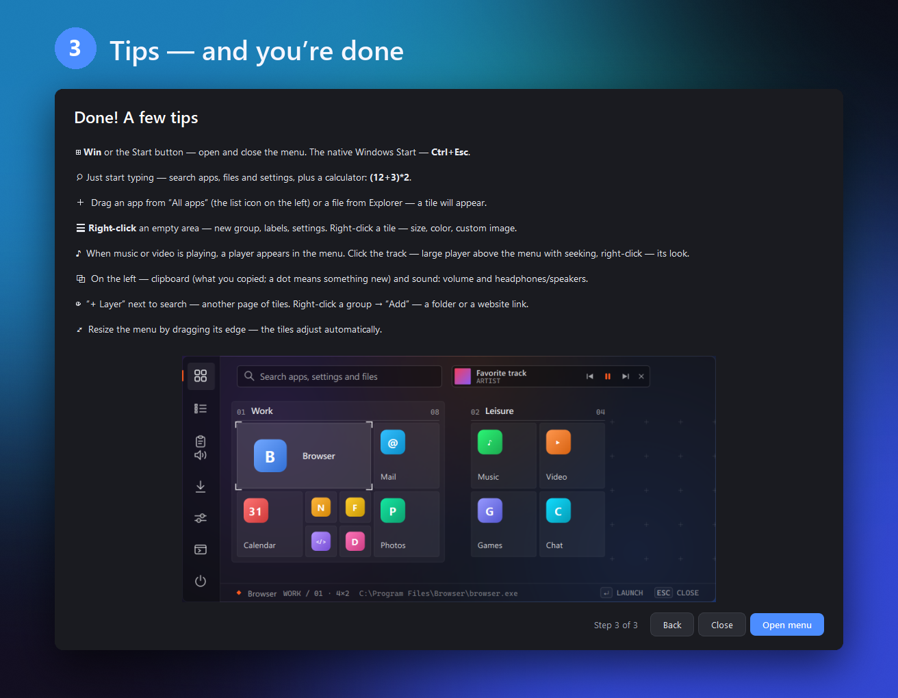</td>
  </tr>
</table>

**Requirements:** Windows 11, 64-bit.

## ❓ FAQ

<details>
<summary><b>How do I open the original Start menu?</b></summary>

`Ctrl+Esc`. All `Win+…` shortcuts keep working. To pause StartMenu: tray icon → *Exit*.
</details>

<details>
<summary><b>How do I uninstall it?</b></summary>

*Settings → Apps → Installed apps → StartMenu → Uninstall.* The Windows Start menu is back immediately.
</details>

<details>
<summary><b>How much memory does it use?</b></summary>

~6 MB in the tray. With *Keep the menu ready* — ~12–25 MB, and it opens instantly.
</details>

<details>
<summary><b>Why does SmartScreen warn me? Is it safe?</b></summary>

The installer isn’t code-signed yet. StartMenu needs no admin rights, installs into your user folder (`%LOCALAPPDATA%\Programs\…`) and doesn’t touch system files. The code is open.
</details>

<details>
<summary><b>Does it send any data?</b></summary>

No telemetry, no accounts. The only request: the icon of a website link you add.
</details>

<details>
<summary><b>How do I move my layout to another PC?</b></summary>

Tray icon → *Open settings folder* → copy `items.json` (tiles) and `settings.json` (look).
</details>

## 🌍 12 languages

English · Русский · Українська · Deutsch · Français · Español · Italiano · Português · Polski · Türkçe · 中文 · 日本語

## 🛠 Build from source

Visual Studio 2022 (C++) + Qt 6.8.3 `msvc2022_64` in `C:\Qt`:

```bat
build.cmd
pwsh -File installer\make-installer.ps1
```

More: [docs/DEVELOPMENT.md](docs/DEVELOPMENT.md) · [Contributing](.github/CONTRIBUTING.md) · [Report a bug](https://github.com/NKF-XXX/StartMenu/issues/new/choose)

## 📄 License

[GPL-3.0](LICENSE) — free to use, study, share and modify; modified versions stay open.

If StartMenu makes your day a little better — **⭐ star the repo**.

<sub>Not affiliated with Microsoft. Windows is a trademark of Microsoft Corporation.</sub>
