<div align="center">

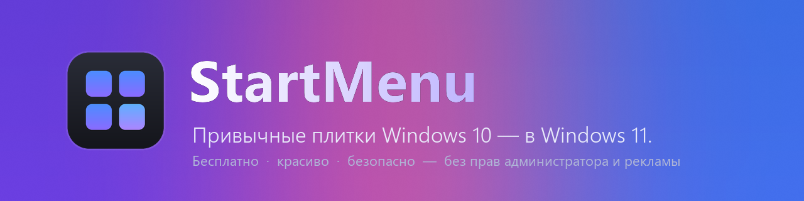

[English](README.md) · **Русский**

[](https://github.com/NKF-XXX/StartMenu/releases/latest)

[](https://github.com/NKF-XXX/StartMenu/releases/latest)
[](https://github.com/NKF-XXX/StartMenu/releases)
[](LICENSE)
[](#-установка-за-1-минуту)
[](https://www.qt.io/)
[](#-сделано-с-помощью-ии)

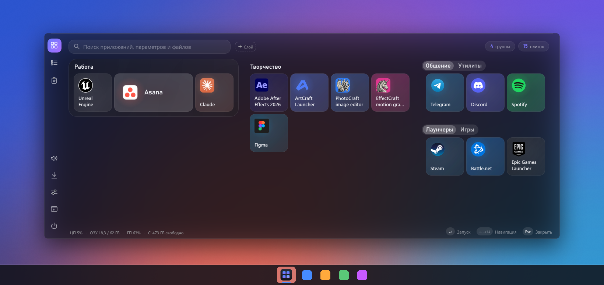

**Группы · папки · 4 размера плиток · мгновенный поиск**<br>
Не патчит Windows · без прав администратора · без рекламы · бесплатно навсегда

</div>

## 🎨 Четыре стиля

<table>
  <tr>
    <td width="50%">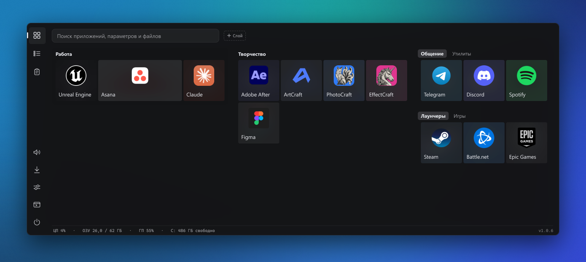<p align="center"><b>Классический</b></p></td>
    <td width="50%">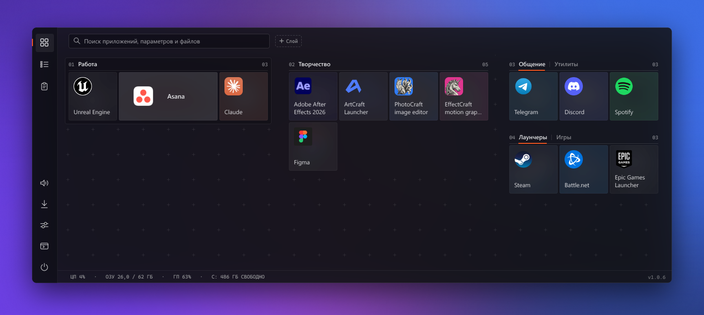<p align="center"><b>Studio</b></p></td>
  </tr>
  <tr>
    <td width="50%">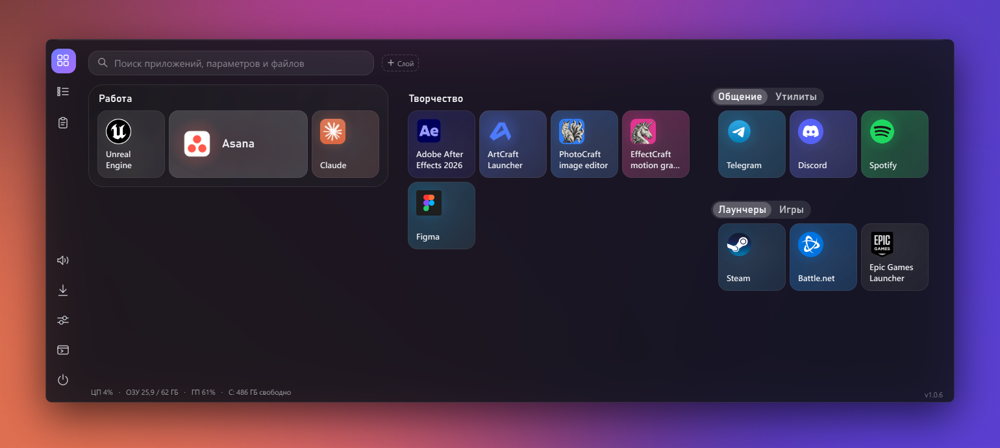<p align="center"><b>Bento</b></p></td>
    <td width="50%">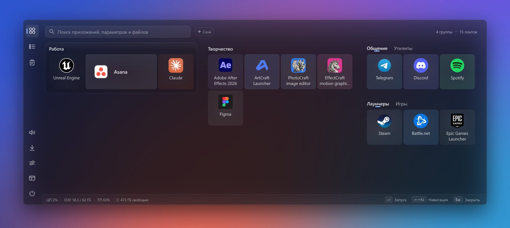<p align="center"><b>Fluent</b></p></td>
  </tr>
</table>

## 🧩 По-вашему

С подписями или только иконки, стекло или сплошной фон — цвета, скругления и размер тоже ваши.

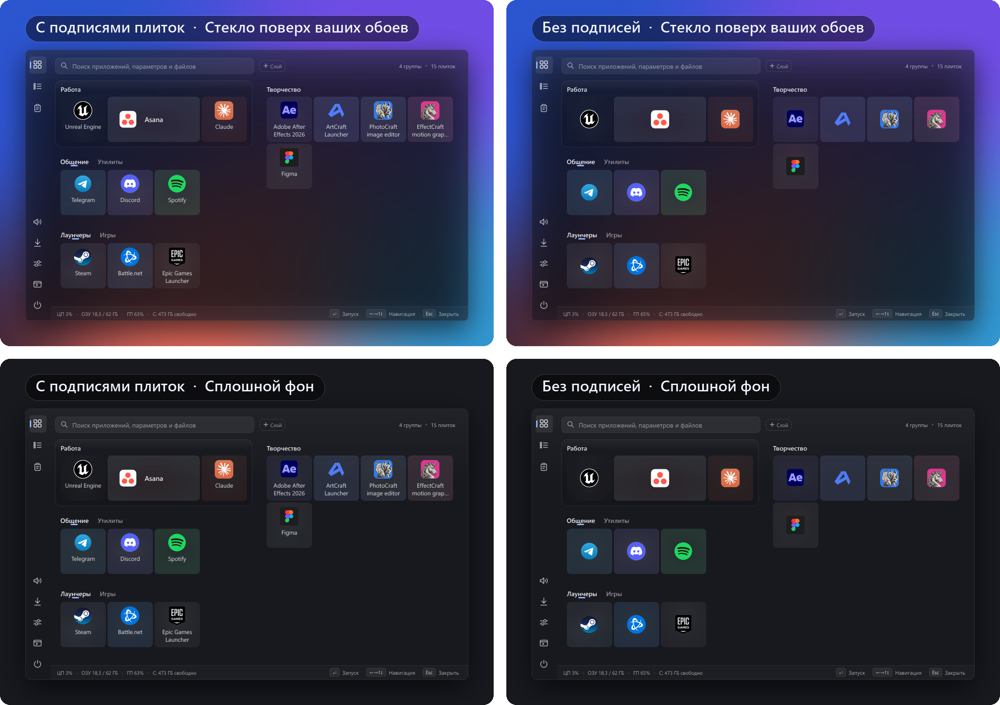

## 🎵 Плеер

Всё, что играет в Windows, — отдельной панелью над меню, с перемоткой и подсветкой в ритм.

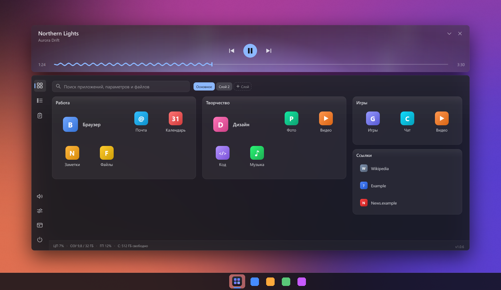

<table>
  <tr>
    <td width="50%">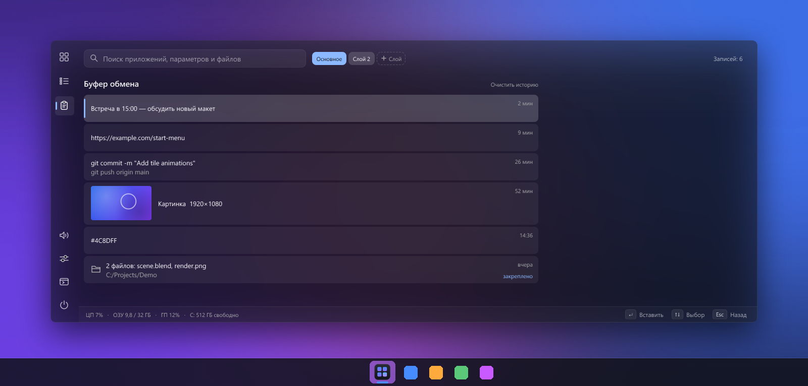<p align="center"><b>📎 История буфера обмена</b></p></td>
    <td width="50%">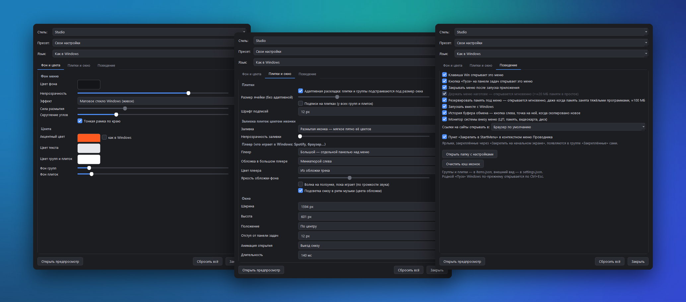<p align="center"><b>⚙️ Любая мелочь — в настройках</b></p></td>
  </tr>
</table>

<p align="center">
🔎 Поиск приложений, параметров и файлов &nbsp;·&nbsp; 🧮 Калькулятор &nbsp;·&nbsp; ⌨️ Понимает неверную раскладку &nbsp;·&nbsp; 📑 Слои<br>
🔊 Громкость и устройство вывода &nbsp;·&nbsp; 📊 Монитор системы &nbsp;·&nbsp; 🌐 Ссылки на сайты &nbsp;·&nbsp; 📌 Закрепление из Проводника &nbsp;·&nbsp; 🎮 Поверх игр
</p>

## 📦 Установка за 1 минуту

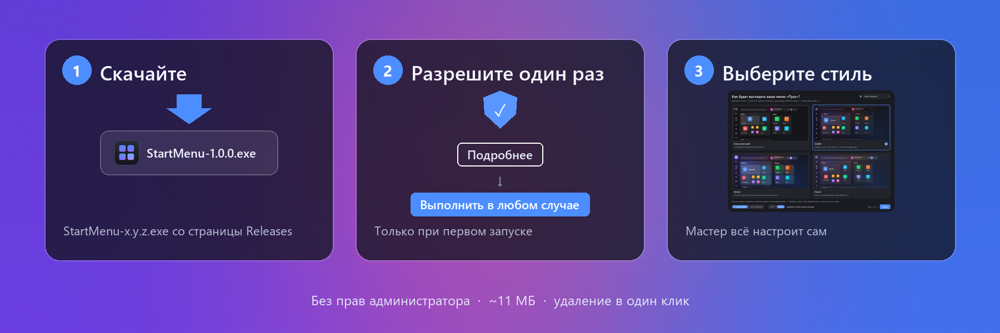

Остальное сделает мастер первого запуска:

<table>
  <tr>
    <td width="33%">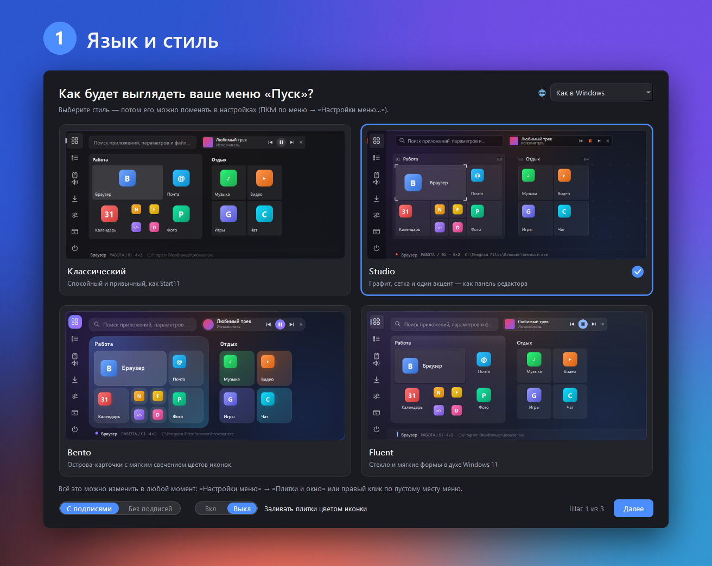</td>
    <td width="33%">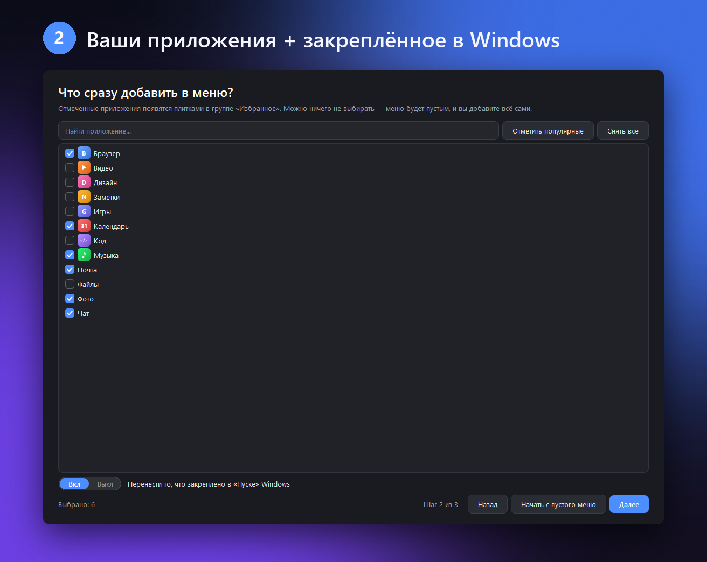</td>
    <td width="33%">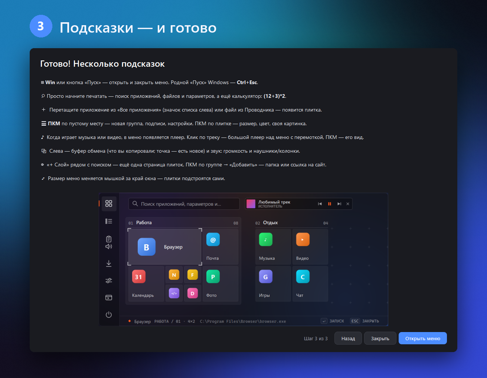</td>
  </tr>
</table>

**Требования:** Windows 11, 64-бит.

## ❓ Вопросы и ответы

<details>
<summary><b>Как открыть родной «Пуск»?</b></summary>

`Ctrl+Esc`. Все сочетания `Win+…` работают как обычно. Выключить StartMenu на время: значок в трее → «Выход».
</details>

<details>
<summary><b>Как удалить?</b></summary>

«Параметры → Приложения → Установленные приложения → StartMenu → Удалить». Родной «Пуск» сразу возвращается.
</details>

<details>
<summary><b>Сколько памяти занимает?</b></summary>

~6 МБ в трее. С «Держать меню наготове» — ~12–25 МБ, и меню открывается мгновенно.
</details>

<details>
<summary><b>Почему ругается SmartScreen? Это безопасно?</b></summary>

Установщик пока не подписан. StartMenu не требует прав администратора, ставится в папку пользователя (`%LOCALAPPDATA%\Programs\…`) и не трогает системные файлы. Код открыт.
</details>

<details>
<summary><b>Программа что-то отправляет?</b></summary>

Нет телеметрии и аккаунтов. Единственный запрос — иконка сайта для ссылки, которую вы добавили.
</details>

<details>
<summary><b>Как перенести раскладку на другой ПК?</b></summary>

Значок в трее → «Открыть папку с настройками» → скопируйте `items.json` (плитки) и `settings.json` (внешний вид).
</details>

## 🌍 12 языков

English · Русский · Українська · Deutsch · Français · Español · Italiano · Português · Polski · Türkçe · 中文 · 日本語

## 🤖 Сделано с помощью ИИ

StartMenu — это **вайб-кодинг**: весь код написал ИИ-ассистент [Claude Code](https://claude.com/claude-code) от Anthropic, а человек, который не является профессиональным программистом, ставил задачи и проверял результат.
Каждая функция проверена вручную на настоящем ПК, а код открыт — любой может его изучить. Но, пожалуйста, учитывайте это и [пишите нам](https://github.com/NKF-XXX/StartMenu/issues/new/choose), если что-то работает странно.

## 🛠 Сборка из исходников

Visual Studio 2022 (C++) + Qt 6.8.3 `msvc2022_64` в `C:\Qt`:

```bat
build.cmd
pwsh -File installer\make-installer.ps1
```

Подробнее: [docs/DEVELOPMENT.md](docs/DEVELOPMENT.md) · [Как помочь проекту](.github/CONTRIBUTING.md) · [Сообщить об ошибке](https://github.com/NKF-XXX/StartMenu/issues/new/choose)

## 📄 Лицензия

[GPL-3.0](LICENSE) — можно использовать, изучать, распространять и изменять; изменённые версии остаются открытыми.

Если StartMenu вам пригодился — **⭐ поставьте звезду**.

<sub>Не связан с Microsoft. Windows — товарный знак Microsoft Corporation.</sub>
